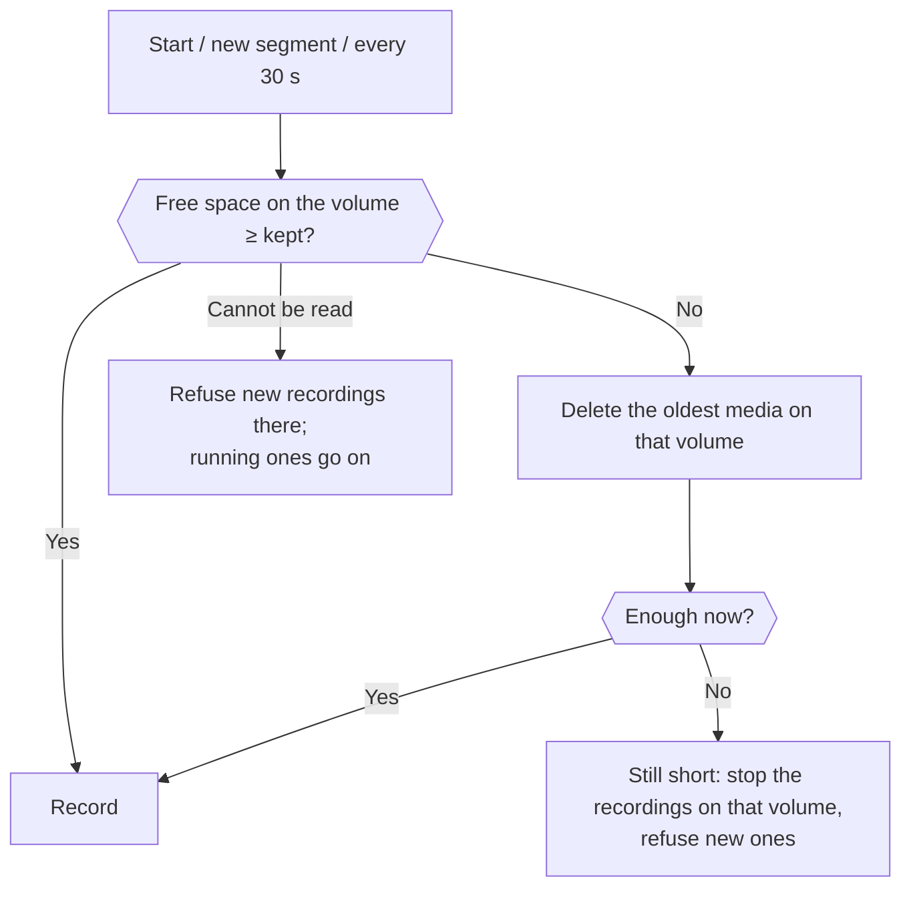

# 💾 Disk Space Guard

Keeps the disks that hold recordings from running full. On every volume that holds media, the guard keeps a set amount of space free by deleting the oldest media first. No recording starts where that space is not there, and a recording stops before it fills a disk. An optional size limit keeps all recordings together within a set size.

## 📖 Overview

One guard (`DiskSpaceGuard`, Core) serves CameraWall and the server. It looks after every folder media is written to:

- **The global recording folder**, or its default when the setting is empty.
- **Each camera's own recording folder** (CameraWall only; the server records every camera below its own folder).
- **The snapshot folder**, which also holds the time-lapse pictures.

The folders are grouped by **volume**: a drive, a volume mounted in a folder, or a network share. On Windows the free space is read for the folder itself, so a network share and a mounted folder are measured correctly.

It runs:

| When | What happens |
|---|---|
| **Every 30 seconds** | Each volume is checked; a short one is reclaimed. The recordings on a volume that is still short are stopped. |
| **Before a recording starts** | The volume of the camera's folder must have the space, after reclaiming. Otherwise the recording does not start. |
| **Before a new segment** | A volume that is still short gets no new segment: the recording stops. |
| **Every hour** (cleanup pass) | Age-based cleanup, then the size limit, then the guard once more. |

## 🗂️ What Is Deleted, In Which Order

- **Oldest first**, by last-write time, across every folder on the short volume: recordings, snapshots and time-lapse pictures together.
- **A recording being written is never deleted**, nor its thumbnail.
- **A recording's thumbnail goes with it**, wherever the layout put it. A camera's own folder inside the global one keeps its thumbnails in its own `thumbnails` folder; they are matched to that folder.
- **A recording thumbnail is never taken for a snapshot**, even when the recording folder is inside the snapshot folder.
- Day and camera folders left empty are removed, once they are a minute old.

## 🚦 When Things Go Wrong

| Situation | What happens |
|---|---|
| A volume is still short after deleting everything it may | The recordings on that volume stop, new ones are refused, and an Error is logged once. Recordings on other volumes go on. |
| The free space of a volume cannot be read (a share that is gone) | New recordings there are refused and an Error is logged once. Running recordings go on: a share that hiccups for a moment must not end 24/7 recording. |
| A write fails (the disk filled from elsewhere, a share went away) | The recorder stops writing and reports why (`RecordingError`); the recording is stopped within 30 seconds and the reason is logged. A packet FFmpeg refuses for its timestamp does not count. |

## ⚙️ Settings Reference

All under `Recording.Cleanup` in `settings.json`, in **Settings → Recording → Media Cleanup** in both desktop apps, and on the **Storage** tab of the web client.

| Setting | API | Default | Description |
|---|---|---|---|
| `EnableDiskSpaceGuard` | `enableDiskSpaceGuard` | `true` | The guard. It runs whatever the cleanup schedule is. |
| `MinFreeSpaceMb` | `minFreeSpaceMb` | `2048` | The space kept free on each volume, in MB. |
| `MaxRecordingStorageGb` | `maxRecordingStorageGb` | `0` | The most space all recordings together may take, in GB; the oldest go first. `0` is no limit. Kept by the hourly cleanup. |

A setting a `PUT /settings` request leaves out keeps its value. `minFreeSpaceMb` as `0` keeps the current value too; `maxRecordingStorageGb` as `0` means no limit.

### Sizing the free space kept

| Kept free | Suitable for |
|---|---|
| 500 MB | Motion-only, low frame rate |
| 1 GB | 1 camera 24/7, or 3 cameras motion-only |
| **2 GB** | **2–3 cameras 24/7 (about 13 minutes at 150 MB/min)** |
| 5 GB | 3–8 cameras 24/7 |
| 10–20 GB | Many cameras or high bitrates |

The guard checks every 30 seconds, so the space kept must hold more than 30 seconds of all cameras together.

## 🌍 Monitoring

`GET /health/recordings` has a `diskSpaceLow` flag, for the server and per recording. It is `true` when the recording folder's volume has less free space than is kept, read the same way as the guard reads it.

## 📋 Log Messages

| Level | Message | Meaning |
|---|---|---|
| Warning | `Disk space low on '{Volume}': … deleted the {Count} oldest files` | The guard made room |
| Error | `Disk space low on '{Volume}' … nothing more may be deleted … Recordings on it are stopped and new ones refused` | Still short (logged when it starts) |
| Error | `The free space of '{Volume}' cannot be read. New recordings there are refused; running ones go on` | Unreadable volume (logged when it starts) |
| Information | `Disk space on '{Volume}': … MB free` | A volume is fine again |
| Error | `Recording of camera '{CameraName}' stopped: nothing more can be written ({Error})` | A write failed |
| Error | `Not enough free space where camera '{CameraName}' records, or it cannot be read: the recording is not started` | The start was refused |

## 🔧 Troubleshooting

- **Recordings stop with "nothing more may be deleted".** The volume is full of files the guard may not delete: recordings being written, or files that are not media. Free space by hand, add disk, or record fewer cameras there.
- **A camera on a network share does not record.** Its free space cannot be read. Check that the share is reachable from the account the app or the server runs under.
- **Recordings disappear sooner than the retention.** The free space kept or the size limit is reached first. Raise the size limit, lower the free space kept, or add disk.
