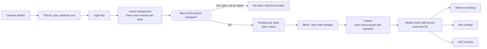
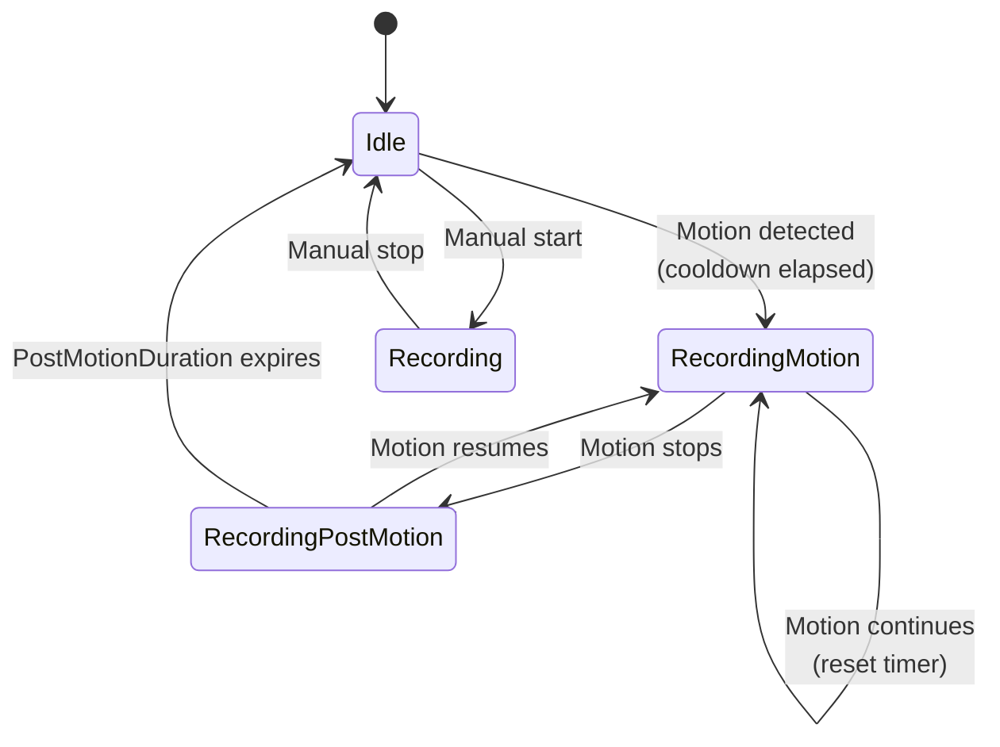

# 🏃 Motion Detection Guide

Setup and configuration guide for the motion detection system in AtcSoft.VideoSurveillance. Covers both the WPF desktop app and the REST API server.

## 📖 Overview

Motion detection learns what each camera's scene looks like without anything moving, finds what differs from it, and follows it from picture to picture. A box is shown only for something that has been seen for a moment **and has travelled**: a person walking by gets one box, a tree swaying in the wind gets none. The same detector (`BuiltInMotionDetector` in Core, behind `IMotionDetector`) runs in CameraWall and on the server.



## 🧮 Detection Algorithm

| Step | What | Why |
|---|---|---|
| 1 | The picture is captured, made grey and scaled to the analysis size: the longer side `AnalysisWidth`, the other following the picture as displayed (`MotionAnalysisSize`), so a 16:9 camera is analysed at 800 × 450 and one turned upright at 450 × 800 | Fewer pixels, less work |
| 2 | A 3×3 blur | Removes sensor noise and compression blocks |
| 3 | A **background per pixel**: a running mean and variance. A pixel is foreground when it differs from the mean by more than a few standard deviations and by a minimum number of grey levels (both from *Sensitivity*) | A moving object differs from the background as a whole figure, not only at its edges, so a slow walker is found. A leaf that keeps moving raises its pixel's variance and stops counting |
| 4 | The background learns: pixels that are background quickly (a few seconds), foreground pixels slowly (a minute) | A parked car becomes background after a while; a passing one does not |
| 5 | **Lighting check**: when most of the picture changes at once, the background is learnt anew and boxes are held back for a moment | Exposure, a cloud or the IR switch at dusk is not an object |
| 6 | **Morphology** on the mask: open (removes specks), close (fills holes) | One blob per object instead of speckle |
| 7 | **Blobs**: connected groups of foreground pixels; blobs smaller than a share of the picture are dropped; blobs within a small gap are merged | One box per object |
| 8 | **Tracker**: each blob is matched to the track it was a moment ago (overlap or nearness, with a guess of where it moved). A track **shows** once it has been seen for 0.4 s **and** has travelled 3 % of the picture's width; it ends after 1 s unseen | Persistence and travel: a swaying branch never travels, a person does. Each box keeps its **track id** |
| 9 | **Motion is on** while a confirmed track exists, and stays on for `PostMotionDurationSeconds` after the last one (`MotionHold`) | Recordings and events do not flicker on and off |

The previous detector (the difference of two pictures in 20×20 cells, motion when `MinimumChangePercent` of the picture changed) remains as `FrameDifferenceMotionDetector`, for comparison in the storybook tests. `MinimumChangePercent` no longer decides motion.

### How it is measured

`test/AtcSoft.VideoSurveillance.Storybook.Tests` draws scenes with known content (an empty scene, a tree in the wind, a slow walker, a car, a human and a cat together, a camera clock) and scores each detector against the truth: recall, false boxes per picture, latency and tracks. Every score is kept in `baseline.json`, and a test fails when one gets worse. See `plans/roadmap-boundingbox.md` for the numbers.

## ⚡ CPU Scheduling

The scheduler prevents CPU spikes when monitoring multiple cameras:

- **Round-robin**: Analyzes one camera per timer tick
- **Dynamic interval**: `interval = 1000ms / (numberOfCameras * maxFrameRate)`
- **Constraints**: Min 16ms (~60 Hz ceiling), Max 500ms, frame rate clamped 2-15 fps
- **Skip rule**: If the previous frame is still being analyzed, the camera is skipped

| Cameras | Max FPS | Analyses/sec | Timer Interval |
|---------|---------|-------------|----------------|
| 1 | 5 | 5 | 200ms |
| 4 | 5 | 20 | 50ms |
| 8 | 3 | 24 | ~42ms |
| 16 | 2 | 32 | ~31ms |

## ⚙️ Settings Reference

### Analysis Settings

| Setting | Type | Default | Range | Description |
|---------|------|---------|-------|-------------|
| `Sensitivity` | int | `30` | 0-100 | Detection threshold. Higher values detect more subtle motion. |
| `MinimumChangePercent` | double | `0.5` | 0.0-100.0 | No longer decides motion (a confirmed track does). Kept so older settings still read. |
| `AnalysisFrameRate` | int | `15` | 1-30 | Target FPS for analysis (internally clamped to 2-15; the server analyses at most 4 a second). |
| `AnalysisWidth` | int | `800` | - | The longer side of the analysed picture (its width for a camera lying down); the other side follows the camera's picture. |
| `AnalysisHeight` | int | `600` | - | Not used any more: the height follows the picture. Kept so older settings still read; deprecated in the API. |
| `PostMotionDurationSeconds` | int | `10` | 1-300 | Seconds to continue reporting motion after it stops. |
| `CooldownSeconds` | int | `5` | 0-60 | Minimum seconds between motion-triggered recordings. |

### Analysis Resolution Presets

The size is the longer side; a 4:3 camera gets the height in brackets, a 16:9 camera less.

| Preset | Longer side | CPU Impact | Use Case |
|--------|-----------|------------|----------|
| Low | 320 (× 240) | Minimal | Many cameras, basic detection |
| Balanced | 480 (× 360) | Low | General purpose |
| Standard | 640 (× 480) | Moderate | Good detection accuracy |
| High | 800 (× 600) | High | High accuracy (default) |
| Very High | 960 (× 720) | Very High | Maximum accuracy |

### Bounding Box Settings

| Setting | Type | Default | Range | Description |
|---------|------|---------|-------|-------------|
| `ShowInGrid` | bool | `false` | - | Display boxes in camera grid view. |
| `ShowInFullScreen` | bool | `false` | - | Display boxes in full-screen view. |
| `Color` | string | `"Red"` | - | Box border color (named color). |
| `Thickness` | int | `2` | 1-10 | Line thickness in pixels. |
| `MinArea` | int | `10` | - | Minimum area to display a box (filters noise). |
| `Padding` | int | `4` | - | Padding around detected regions in pixels. |
| `Smoothing` | double | `0.3` | 0.0-1.0 | Smoothing factor for box position transitions. |

### Smoothing Behavior

The smoothing factor uses linear interpolation between frames to reduce jitter:

```
alpha = 1.0 - SmoothingFactor
smoothed.Position = Lerp(previous.Position, current.Position, alpha)
```

| Smoothing | Behavior |
|-----------|----------|
| 0.0 | No smoothing, boxes jump to exact positions |
| 0.3 | Moderate smoothing (default), natural movement |
| 0.7 | Heavy smoothing, slow transitions |
| 1.0 | Maximum smoothing, boxes barely move |

## 🔴 Motion-Triggered Recording



### Recording States

| State | Description |
|-------|-------------|
| `Idle` | Not recording |
| `Recording` | Manual recording (takes priority over motion) |
| `RecordingMotion` | Recording triggered by motion detection |
| `RecordingPostMotion` | Motion stopped, recording continues for PostMotionDurationSeconds |

### Recording Flow

1. **Motion detected**: If `EnableRecordingOnMotion` is enabled and cooldown has elapsed, recording starts in `RecordingMotion` state.
2. **Motion continues**: Each motion event resets the post-motion timer.
3. **Motion stops**: Transitions to `RecordingPostMotion`. A timer counts down `PostMotionDurationSeconds`.
4. **Timer expires**: If no new motion occurs, recording stops and returns to `Idle`.
5. **Motion resumes**: If motion is detected during post-motion countdown, returns to `RecordingMotion` and timer resets.

### Cooldown

The `CooldownSeconds` setting prevents rapid recording cycles. After a motion-triggered recording ends, new motion events are ignored for the cooldown period.

### Manual Recording Priority

If a user starts manual recording, it takes priority. Motion events are still processed (bounding boxes still display) but cannot start or stop a manual recording.

## 🖥️ Setup: WPF Desktop App

### 1. Configure Global Motion Detection Settings

Open **Settings** (View tab) and navigate to the **Motion Detection** tab:

- Set **Sensitivity** (start with 30, increase if motion is missed, decrease if false positives)
- Set **Analysis Resolution** (lower for more cameras, higher for better accuracy)
- Set **Post-Motion Duration** (how long to keep recording after motion stops)
- Set **Cooldown** (minimum gap between recordings)

### 2. Configure Bounding Box Display

In the same **Motion Detection** tab, under **Bounding Box** section:

- Enable **Show in Grid** and/or **Show in Full Screen**
- Choose a **Color** (Red is recommended for visibility)
- Set **Thickness** (2-3 pixels typical)
- Set **Min Area** (increase to filter small noise)
- Adjust **Smoothing** (0.3 is a good starting point)

### 3. Enable Motion-Triggered Recording

Navigate to the **Recording** tab in Settings:

- Enable **Record on Motion Detection**
- Configure **Recording Path** and **Recording Format**
- Optionally enable **Hourly Segmentation** for manageable file sizes

### 4. Per-Camera Overrides (Optional)

Right-click a camera tile → **Edit** → navigate to the **Motion Detection** overrides tab:

- Toggle individual settings to **Override Locally**
- Useful for cameras in high-traffic areas (lower sensitivity) or quiet areas (higher sensitivity)

### 5. Motion Zones (Optional)

Right-click a camera tile → **Edit** → **Motion zones**. A zone's **Type** is one of:

- **Ignore movement**: movement inside it is left out (a road beyond the fence, a busy display, the
  tree that sways too much). It does not count towards motion or the activity timeline.
- **Watch with its own values**: inside it its own **Sensitivity** (0 to 100, as the camera's) and
  **Smallest object** (in percent of the picture; the default is 0.02) count instead of the camera's
  (a gate where a small animal matters, a corner the camera's settings are too blunt for). An empty
  field takes the camera's sensitivity and the default size. An object counts in the zone its middle
  is in. Where zones overlap, an ignore zone wins, and of two watch zones the one added last.
  A watch zone's **Color on the timeline** colours the events that happened in it under the player
  (orange without one). Events are linked to a zone by its name: a renamed zone loses its colour on
  older recordings, and of two zones with one name the first one's colour counts.

- **Take Snapshot** shows the camera's picture now (from its tile, or from the camera opened for it);
  without one the zones are drawn on a grey picture of the same shape.
- **Add zone** puts a square in the middle. Drag the zone by its inside and its corners by their
  handles; double-click an edge to add a corner there, or a corner to remove it (**Add corner** and
  **Remove corner** do the same from the keyboard).
- Up to 16 zones, 3 to 32 corners each. The corners are fractions of the picture as it is shown, so
  they fit any analysis size; a new rotation chosen in the dialog turns them with the picture.
- Save hands the zones to the running analysis at once; it keeps what it has learnt of the scene.

### 6. Verify Detection

- Watch for bounding boxes appearing on camera tiles (if enabled)
- Check the recording indicator when motion triggers recording
- Use the **Recordings Browser** (View tab) to review motion-triggered recordings

## 🌍 Setup: REST API Server

The server watches every camera that has *record on motion* on, records while something moves, and sends motion events to its clients and webhooks. It analyses at most four pictures a second, and it needs Windows. See [server.md](server.md#-motion-detection) for how it behaves.

### 1. Configure Settings via API

```http
PUT /settings
Content-Type: application/json

{
  "motionSensitivity": 30,
  "minimumChangePercent": 0.5,
  "analysisFrameRate": 5,
  "analysisWidth": 640,
  "analysisHeight": 480,
  "postMotionDurationSeconds": 10,
  "cooldownSeconds": 5,
  "boundingBoxShowInGrid": true,
  "boundingBoxColor": "Red",
  "boundingBoxThickness": 2,
  "boundingBoxMinArea": 25,
  "enableRecordingOnMotion": true,
  "recordingFormat": "mkv"
}
```

The settings resource is flat. Send only the settings you change: the server keeps every setting the request leaves out.

### 2. Per-Camera Overrides

Per-camera motion overrides are not part of the API; they are set in the desktop apps.

A camera's zones are `motionZones` on the camera (`GET /cameras/{id}`), each a `name`, a `kind`
(`ignore` or `watch`), 3 to 32 `points` (`x`, `y` from 0 to 1 of the picture as shown) and, for a
watch zone, an optional `sensitivity` (0 to 100) and `smallestObjectPercent` (0 to 100); left out,
they are the camera's sensitivity and the default size (not "keep what is stored", as for an update). An update without `motionZones` keeps them (turned with a new
`rotation`), `[]` removes them. Both API clients draw them on a snapshot from
`GET /cameras/{id}/snapshot`, which for a camera being recorded is taken from the recording. Like
every snapshot, each one is also saved in the server's snapshot folder; the clean-up removes old ones
only when it includes snapshots (`cleanupIncludeSnapshots`, off by default).

### 3. Monitor Events

Read the server's event stream (`GET /events`, Server-Sent Events); see `docs/server.md` for resuming after a drop:

```javascript
const events = new EventSource("http://localhost:5000/events");

events.onmessage = (message) => {
    const event = JSON.parse(message.data);

    // Motion detection events
    if (event.motion) {
        console.log(`Camera ${event.cameraId}: motion=${event.motion.isMotionActive}`);
        console.log(`Change: ${event.motion.changePercentage}%`);
        console.log(`Boxes: ${event.motion.boundingBoxes.length}`);
        // event.motion.boundingBoxes: [{ x, y, width, height }]
        // event.motion.analysisWidth, event.motion.analysisHeight for coordinate mapping
    }

    // Recording state changes (triggered by motion)
    if (event.recording) {
        console.log(`Camera ${event.cameraId}: ${event.recording.oldState} → ${event.recording.newState}`);
        if (event.recording.filePath) console.log(`File: ${event.recording.filePath}`);
    }
};
```

### Events

| `type` | Part | Description |
|-------|---------|-------------|
| `motionDetected` | `motion`: `{ cameraId, isMotionActive, changePercentage, boundingBoxes[], analysisWidth, analysisHeight, timestamp }` | Fired when motion state changes or bounding boxes update |
| `recordingStateChanged` | `recording`: `{ cameraId, newState, oldState, filePath, timestamp }` | Fired when recording starts/stops (including motion-triggered) |
| `connectionStateChanged` | `connection`: `{ cameraId, newState, timestamp }` | Fired when camera connection state changes |

### Bounding Box Coordinate Mapping

Bounding box coordinates are relative to the analysis resolution. To map to actual video or display dimensions:

```
displayX = (box.X / analysisWidth) * displayWidth
displayY = (box.Y / analysisHeight) * displayHeight
displayW = (box.Width / analysisWidth) * displayWidth
displayH = (box.Height / analysisHeight) * displayHeight
```

## 📈 Performance Tuning

### Reducing CPU Usage

| Strategy | Setting | Impact |
|----------|---------|--------|
| Lower frame rate | `AnalysisFrameRate: 2-4` | Major reduction, slight delay in detection |
| Lower resolution | `AnalysisWidth: 320` | Major reduction, may miss small motion |
| Increase sensitivity threshold | `Sensitivity: 10-20` | Fewer false positives, less processing |

### Memory Usage Per Camera

| Longer side (4:3 camera) | Buffer Size | Suitable For |
|-----------|-------------|--------------|
| 320 | ~76 KB | Many cameras (16+) |
| 480 | ~170 KB | Medium deployments (8-16) |
| 640 | ~300 KB | Standard deployments (4-8) |
| 800 | ~480 KB | Few cameras (1-4) |

### Recommended Configurations

**Low-resource server (many cameras)**:
```json
{
  "analysisFrameRate": 2,
  "analysisWidth": 320,
  "sensitivity": 20,
  "smallestObjectPercent": 0.1
}
```

**Balanced (general purpose)**:
```json
{
  "analysisFrameRate": 5,
  "analysisWidth": 640,
  "sensitivity": 30,
  "smallestObjectPercent": 0.02
}
```

**High accuracy (few cameras, security-critical)**:
```json
{
  "analysisFrameRate": 10,
  "analysisWidth": 800,
  "sensitivity": 50,
  "smallestObjectPercent": 0.01
}
```

## 🔧 Troubleshooting

### False Positives

- **Symptom**: Motion detected when nothing is moving.
- **Causes**: Lighting changes, camera noise, wind-blown objects.
- **Solutions**:
  - Decrease `Sensitivity` (try 15-20)
  - Something that only sways (a tree, a flag) gets no box: it never travels. If it does, report the scene, so it can become a storybook test
  - Draw an ignore zone over what moves but does not matter (see *Motion Zones* above): it no longer counts towards motion or the activity timeline
  - Lighting changes are learnt away; a box right after the IR switch should vanish within a few seconds

### Missed Motion

- **Symptom**: Objects move but motion is not detected.
- **Causes**: Sensitivity too low, resolution too low, objects too small.
- **Solutions**:
  - Increase `Sensitivity` (try 50-70)
  - Only in part of the picture: a watch zone there with a higher sensitivity or a smaller smallest object (see *Motion Zones* above)
  - Increase analysis resolution
  - A box shows only after something has moved 3 % of the picture's width, so the first half second of a slow walker has none

### High CPU Usage

- **Symptom**: CPU usage spikes with motion detection enabled.
- **Solutions**:
  - Reduce `AnalysisFrameRate` to 2-4 fps
  - Reduce the analysis size to 320 or 480
  - Use per-camera overrides to lower settings on less important cameras

### Recording Gaps

- **Symptom**: Gaps between motion-triggered recordings.
- **Causes**: Cooldown too long, post-motion too short.
- **Solutions**:
  - Reduce `CooldownSeconds` (try 2-3)
  - Increase `PostMotionDurationSeconds` (try 15-30)
