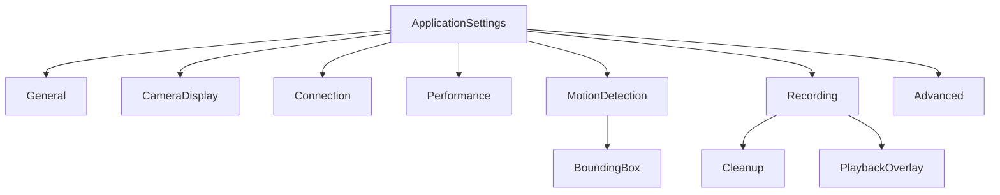

# ⚙️ AtcSoft.VideoSurveillance Settings Reference

Complete reference for all application settings and parameters. Settings are stored as JSON in `%ProgramData%\AtcSoft\CameraWall\settings.json` and are shared between the WPF desktop app and the REST API server.

## 📊 Settings Hierarchy



Settings support per-camera overrides via nullable override models. When a camera override is `null`, the application default is used. The `GetEffectiveValue()` method resolves the final value.

---

## 🎨 General Settings

UI and startup behavior. **WPF only** (not exposed via API settings endpoint).

| Setting | Type | Default | Description |
|---------|------|---------|-------------|
| `ThemeBase` | string | `"Dark"` | Application theme: `"Dark"` or `"Light"` |
| `ThemeAccent` | string | `"Blue"` | Theme accent color name |
| `Language` | string | `"1033"` | LCID language code (1033 = en-US) |
| `ConnectCamerasOnStartup` | bool | `true` | Auto-connect all cameras on application start |
| `StartMaximized` | bool | `false` | Launch application in maximized window state |
| `StartRibbonCollapsed` | bool | `false` | Start with the Ribbon UI collapsed |

---

## 🖥️ Camera Display Settings

Camera overlay and grid layout defaults. Per-camera overrides available for overlay properties.

| Setting | Type | Default | Override | Description |
|---------|------|---------|----------|-------------|
| `ShowOverlayTitle` | bool | `true` | Yes | Display camera name in overlay |
| `ShowOverlayDescription` | bool | `true` | Yes | Display camera description in overlay |
| `ShowOverlayTime` | bool | `false` | Yes | Display current time in overlay |
| `ShowOverlayConnectionStatus` | bool | `true` | Yes | Display connection status indicator in overlay |
| `ShowOverlayQuickActions` | bool | `true` | Yes | Show the quick-action buttons (full screen, zoom reset) in the corner diagonal to the info box |
| `ShowOverlayConnectionTypeIcon` | bool | `false` | Yes | Show the connection-type icon (LAN / Wi-Fi / USB), tinted by link health. Cameras whose type is `None` show nothing |
| `ConnectionTypeIconPlacement` | enum | `SameRow` | Yes | Which corner next to the info box holds the icon — see [Connection-Type Icon Placement](#connection-type-icon-placement) |
| `OverlayOpacity` | double | `0.7` | Yes | Overlay transparency (0.0 = transparent, 1.0 = opaque) |
| `OverlayPosition` | enum | `TopLeft` | No* | Default overlay position |
| `AllowDragAndDropReorder` | bool | `true` | No | Allow drag-and-drop camera reordering in grid |
| `AutoSaveLayoutChanges` | bool | `true` | No | Auto-save layout changes without prompting |
| `SnapshotPath` | string | `{ProgramData}\...\snapshots` | No | Default directory for camera snapshots |

*Overlay position is set per-camera in the camera's Display settings, not via the override system.

### Connection-Type Icon Placement

A tile's info box uses one corner and the quick actions use the diagonally opposite one. The icon uses one of the two remaining corners, chosen *relative to the info box*, so it never overlaps either one, whatever overlay position a camera has:

| Info box at | `SameRow` → icon at | `SameColumn` → icon at |
|---|---|---|
| TopLeft | TopRight | BottomLeft |
| TopRight | TopLeft | BottomRight |
| BottomLeft | BottomRight | TopLeft |
| BottomRight | BottomLeft | TopRight |

The settings dialogs label each option with the concrete corner it resolves to. In the full-screen window the close button owns the top-right corner, so the icon uses the other adjacent corner when needed. The API-client app shows the glyph inline in the tile badge instead, next to the connection status.

### Overlay Position Options

- `TopLeft` (default)
- `TopRight`
- `BottomLeft`
- `BottomRight`

---

## 🔌 Connection Settings

Connection behavior, defaults for new cameras, and notification preferences.

| Setting | Type | Default | Override | Description |
|---------|------|---------|----------|-------------|
| `DefaultProtocol` | enum | `Rtsp` | No | Default protocol for new cameras |
| `DefaultPort` | int | `554` | No | Default port for new cameras |
| `ConnectionTimeoutSeconds` | int | `10` | Yes | Timeout in seconds for connection attempts |
| `ReconnectDelaySeconds` | int | `10` | Yes | Delay in seconds before reconnection attempt |
| `AutoReconnectOnFailure` | bool | `true` | Yes | Automatically reconnect on connection loss |
| `ShowNotificationOnDisconnect` | bool | `true` | Yes | Show notification when camera disconnects |
| `ShowNotificationOnReconnect` | bool | `false` | Yes | Show notification when camera reconnects |
| `PlayNotificationSound` | bool | `false` | Yes | Play audio alert on connectivity events |

### Camera Protocol Options

| Protocol | Default Port | Description |
|----------|-------------|-------------|
| `Rtsp` | 554 | Real Time Streaming Protocol |
| `Http` | 80 | HTTP streaming |
| `Https` | 443 | HTTPS streaming (secure) |

---

## 📈 Performance Settings

Video playback and streaming configuration.

| Setting | Type | Default | Override | Description |
|---------|------|---------|----------|-------------|
| `VideoQuality` | string | `"Auto"` | Yes | Target video resolution limit — one of the values below, the same in every client and in the API |
| `HardwareAcceleration` | bool | `true` | Yes | Use GPU acceleration (D3D11VA) for decoding |
| `LowLatencyMode` | bool | `false` | No | Enable low-latency streaming (reduces buffer) |
| `BufferDurationMs` | int | `500` | No | Video buffer duration in milliseconds |
| `RtspTransport` | string | `"tcp"` | No | RTSP transport protocol |
| `MaxLatencyMs` | int | `500` | No | Maximum acceptable latency in milliseconds |

### Video Quality Options

| Quality | Max Resolution | Description |
|---------|---------------|-------------|
| `Auto` | Source | No limit, use original quality |
| `1080p` | 1920x1080 | Full HD |
| `720p` | 1280x720 | HD |
| `480p` | 854x480 | Standard |
| `360p` | 640x360 | Low |

### RTSP Transport Options

| Transport | Description |
|-----------|-------------|
| `tcp` | Reliable, may have higher latency (default) |
| `udp` | Faster but less reliable, better for LAN |

---

## 🏃 Motion Detection Settings

Frame-based motion analysis configuration. See [motion-detection.md](motion-detection.md) for detailed setup guide.

| Setting | Type | Default | Override | Description |
|---------|------|---------|----------|-------------|
| `Sensitivity` | int | `30` | Yes | Detection threshold (0-100, higher = more sensitive) |
| `MinimumChangePercent` | double | `0.5` | Yes | Minimum % of frame change to trigger detection |
| `AnalysisFrameRate` | int | `30` | Yes | Frames per second for motion analysis (clamped 2-15) |
| `AnalysisWidth` | int | `800` | Yes | Width of analysis frame in pixels |
| `AnalysisHeight` | int | `600` | Yes | Height of analysis frame in pixels |
| `PostMotionDurationSeconds` | int | `10` | Yes | Seconds to continue reporting motion after it stops |
| `CooldownSeconds` | int | `5` | Yes | Minimum seconds between motion-triggered recordings |
| `BoundingBox` | object | *(see below)* | Yes | Bounding box visualization settings |

### Bounding Box Settings

| Setting | Type | Default | Override | Description |
|---------|------|---------|----------|-------------|
| `ShowInGrid` | bool | `false` | Yes | Display bounding boxes in camera grid view |
| `ShowInFullScreen` | bool | `false` | Yes | Display bounding boxes in full-screen view |
| `Color` | string | `"Red"` | Yes | Box color (named color: Red, Green, Blue, Cyan, Yellow, etc.) |
| `Thickness` | int | `2` | Yes | Line thickness in pixels (1-10) |
| `MinArea` | int | `10` | Yes | Minimum area in pixels to display a box (filters noise) |
| `Padding` | int | `4` | No | Padding around detected motion regions in pixels |
| `Smoothing` | double | `0.3` | Yes | Smoothing factor for box transitions (0.0-1.0) |

---

## 🔴 Recording Settings

Recording paths, formats, segmentation, and timelapse configuration.

| Setting | Type | Default | Override | Description |
|---------|------|---------|----------|-------------|
| `RecordingPath` | string | `{ProgramData}\...\recordings` | Yes | Directory for storing recordings |
| `RecordingFormat` | string | `"mkv"` | Yes | Container format for recordings |
| `TranscodeVideoCodec` | enum | `None` | Yes | `None` records what the camera sends, untouched. `H264` records every camera as H.264 — see [Recording as H.264](#recording-as-h264) |
| `EnableRecordingOnMotion` | bool | `false` | Yes | Auto-record when motion is detected |
| `EnableRecordingOnConnect` | bool | `false` | Yes | Auto-record when camera connects |
| `EnableHourlySegmentation` | bool | `true` | No | Split recordings into clock-aligned segments |
| `MaxRecordingDurationMinutes` | int | `60` | No | Maximum segment length in minutes |
| `ThumbnailTileCount` | int | `4` | Yes | Thumbnail grid: 1 (single 320x240) or 4 (2x2 640x480) |
| `UseDailySubfolders` | bool | `true` | No | Put each day's recordings in their own `yyyy-MM-dd` folder — see [Recording Folder Layout](#recording-folder-layout) |
| `SeparateThumbnailFolder` | bool | `true` | No | Keep thumbnails in a `thumbnails` folder below the recording path |
| `CloseRecordingsBrowserOnPlay` | bool | `false` | No | CameraWall app only: close the recordings browser when a recording is played. Off keeps it open behind the player, ready for the next recording |
| `RememberRecordingsBrowserState` | bool | `true` | No | CameraWall app only: reopen the recordings browser with the filters and the recording last used. Remembered until the app is closed |
| `EnableTimelapse` | bool | `false` | Yes | Enable interval-based timelapse snapshots |
| `TimelapseInterval` | string | `"5m"` | Yes | Timelapse capture interval |
| `Cleanup` | object | *(see below)* | No | Media cleanup settings |
| `PlaybackOverlay` | object | *(see below)* | No | Playback overlay settings |

### Recording as H.264

A camera's video is normally copied into the recording as it arrives, which costs next to nothing. With `TranscodeVideoCodec` set to `H264` (*Recording video: Always H.264* in the settings dialog, *Always record as H.264* in the web client; `recordAsH264` in the API), a camera that sends anything else is decoded and encoded again while it is recorded:

- **Why:** H.265 halves the file, but not every player takes it and no browser on Windows does. As H.264 the recordings play everywhere.
- **Which cameras:** those that send H.265 or MJPEG. A camera that already sends H.264 is copied as before, whatever the setting. A USB camera that delivers uncompressed video is always encoded.
- **Cost:** processor time for every such camera, and larger files. One 1280x720 H.265 camera at 15 pictures a second took about a sixth of a processor core on the server instead of a twentieth, and its recording grew from about 1.1 to about 4 Mbit/s.
- **When:** the choice is read when a camera is opened, so a change reaches a camera the next time it connects.
- **Per camera:** `Overrides.Recording.TranscodeVideoCodec` overrides the application's choice for one camera. In CameraWall it is the *Recording video* row under the camera dialog's capture overrides. Cameras kept on the server have no per-camera overrides, so there the application's choice counts for all of them.

### Recording Format Options

| Format | Description |
|--------|-------------|
| `mkv` | Matroska container (default, better codec support) |
| `mp4` | MPEG-4 container (wider playback compatibility) |

### Transcode Codec Options

| Codec | Description |
|-------|-------------|
| `None` | Copy original stream (fastest, no re-encoding) |
| `H264` | Transcode to H.264 (slower, guaranteed compatibility) |

### Timelapse Interval Options

`10s`, `30s`, `1m`, `5m` (default), `10m`, `30m`, `1h`, `3h`, `6h`, `12h`, `24h`

### Recording Folder Layout

With continuous recording, one folder per camera holding every video and
thumbnail grows by two files per segment — about 19,000 files after 100 days of
15-minute segments — which Windows Explorer handles badly. Two independent
options, both on by default, keep the folders small:

| `UseDailySubfolders` | `SeparateThumbnailFolder` | Video | Thumbnail |
|---|---|---|---|
| off | off | `{camera}\{file}.mkv` | `{camera}\{file}.png` |
| on | off | `{camera}\2026-10-12\{file}.mkv` | `{camera}\2026-10-12\{file}.png` |
| off | on | `{camera}\{file}.mkv` | `thumbnails\{camera}\{file}.png` |
| on | on | `{camera}\2026-10-12\{file}.mkv` | `thumbnails\{camera}\2026-10-12\{file}.png` |

All paths are below `RecordingPath`. File names do not change.

- **The folder always follows the settings.** When an option is changed, the
  existing recordings and thumbnails are moved to the new layout: in the
  standalone app while the settings dialog saves (it shows a busy indicator),
  on the server while the settings update is handled. A running recording
  cannot be moved, so it is restarted first — it closes its file and carries on
  in a new one at the new place. Both also check once at startup.
- The recordings browser, the API and cleanup read every layout, so the list of
  recordings looks the same before, during and after a move.
- In the settings dialog each switch has a hover help showing its path when on
  and when off, and an example of the current choice is shown below them.
- A file that cannot be moved (in use, or its new name is taken) stays where it
  is, remains listed, and is retried at the next start. Nothing is overwritten.
- The day folder follows the **local** calendar day on which the file was
  started. With segmentation on, midnight is always a segment boundary, so each
  file lands in its own day. On the server, file names carry a UTC timestamp
  while the day folder is still the local day.
- Day and camera folders that become empty through cleanup, disk-space reclaim
  or a delete in the recordings browser are removed.
- A thumbnail whose recording you deleted by hand is removed on the next
  scheduled cleanup pass.
- A camera cannot use the folder name `thumbnails`; such a camera's folder is
  named `thumbnails_`.

### Recording Segmentation

When `EnableHourlySegmentation` is enabled, recordings are split at clock-aligned boundaries. For example, with `MaxRecordingDurationMinutes = 60`, files are segmented at :00 each hour. With 15 minutes, segments occur at :00, :15, :30, :45.

### Media Cleanup Settings

| Setting | Type | Default | Description |
|---------|------|---------|-------------|
| `Schedule` | enum | `Disabled` | When to run cleanup |
| `RecordingRetentionDays` | int | `30` | Keep recordings for this many days |
| `IncludeSnapshots` | bool | `false` | Also clean up old snapshots |
| `SnapshotRetentionDays` | int | `7` | Keep snapshots for this many days |
| `EnableDiskSpaceGuard` | bool | `true` | Automatically reclaim disk space before starting recordings and after each scheduled cleanup pass |
| `MinFreeSpaceMb` | int | `2048` | Minimum free disk space in MB to maintain (oldest recordings deleted first when below this threshold) |

#### Cleanup Schedule Options

| Schedule | Description |
|----------|-------------|
| `Disabled` | No automatic cleanup (default) |
| `OnStartup` | Clean up when application starts |
| `OnStartupAndPeriodically` | Clean up on startup and every 6 hours |

### Playback Overlay Settings

| Setting | Type | Default | Description |
|---------|------|---------|-------------|
| `ShowFilename` | bool | `true` | Display recording filename during playback |
| `FilenameColor` | string | `"White"` | Color of filename text |
| `ShowTimestamp` | bool | `true` | Display current timestamp during playback |
| `TimestampColor` | string | `"White"` | Color of timestamp text |

---

## 🔧 Advanced Settings

Debugging and logging configuration.

| Setting | Type | Default | Description |
|---------|------|---------|-------------|
| `EnableDebugLogging` | bool | `false` | Enable verbose logging to file |
| `LogPath` | string | `{ProgramData}\...\logs` | Directory for log files |

When debug logging is enabled:
- **WPF App**: Logs to `{LogPath}\camera-wall-{date}.log`
- **API Server**: Logs to `{LogPath}\video-surveillance-api-{date}.log`
- Both use daily rolling with 7-day retention

---

## 📷 Per-Camera Configuration

In addition to the override system, each camera has its own direct configuration properties.

### 🔌 Connection Settings (per camera)

| Setting | Type | Default | Description |
|---------|------|---------|-------------|
| `Source` | enum | `Network` | Camera source kind — see [Source Options](#camera-source-options). Disabled in the dialog after the camera is created (the source kind is part of the camera's identity). |
| `IpAddress` | string | `""` | Network camera only — IP address or hostname |
| `Protocol` | enum | `Rtsp` | Network camera only — streaming protocol |
| `Port` | int | `554` | Network camera only — streaming port (1-65535) |
| `Path` | string | `null` | Network camera only — optional stream path (e.g., `/stream`) |
| `Usb` | object | `null` | USB camera only — see [USB Connection Settings](#usb-connection-settings-per-camera) |
| `ConnectionType` | enum | `None` | Physical link, shown by the connection-type icon — see [Connection Type Options](#connection-type-options). Display-only: changing it never restarts the stream |

Network and USB shapes are mutually exclusive. The unused branch's fields are ignored at runtime. The `AtcSoft.VideoSurveillance.Wpf.Core` dialog (`CameraConfigurationDialog`) presents `Source` as a radio at the top; the IP/Port/Auth fields and the USB device picker swap into view based on the selection.

#### Camera Source Options

| Source | Description |
|--------|-------------|
| `Network` | IP / RTSP / HTTP camera. Uses `IpAddress`, `Port`, `Protocol`, `Path`, and optional authentication. |
| `Usb` | Local DirectShow / UVC webcam attached to the host. Uses the `Usb` sub-object. Windows-only at present (Linux V4L2 / macOS AVFoundation are Phase ≥10). |

#### Connection Type Options

| ConnectionType | Description |
|----------------|-------------|
| `None` | Not set / unknown (default; cameras saved before this setting existed load as `None`). No icon is shown |
| `Lan` | Wired Ethernet / PoE |
| `Wifi` | Wireless (IEEE 802.11) |
| `Usb` | Local USB camera. Always the effective value when `Source = Usb`, whatever is stored |

The value is set by hand in the camera dialog, or detected over ONVIF (`GetNetworkInterfaces`):

- **Automatically**, after a network camera's first successful connect (and after a successful *Test Connection* in the camera dialog). Automatic detection only fills in a value that is still `None`; it never overwrites one.
- **On request**, with the **Detect** button in the camera dialog. This may overwrite the current value. In the API-client apps, Detect is available when editing an existing camera and runs on the server with the stored credentials (`POST /cameras/{id}/detect-connection-type`, which returns the result without saving it).

Detection returns `None` when the camera has no ONVIF service, rejects the credentials, or reports an unknown interface type. The user can always change the value by hand afterwards.

### USB Connection Settings (per camera)

Populated when `Source = Usb`; `null` otherwise. Lives under `Connection.Usb` in `cameras.json` and behind the "USB" branch of the camera configuration dialog (`UsbDevicePart`).

| Setting | Type | Default | Description |
|---------|------|---------|-------------|
| `DeviceId` | string | *(required)* | Stable DirectShow / Media Foundation symbolic link (e.g., `\\?\usb#vid_046d&pid_085e&mi_00#...`). The only identifier that survives a USB hub reshuffle — never use `FriendlyName` for identity. Locked in the dialog after the camera is created. |
| `FriendlyName` | string | `""` | Human-readable name reported by the OS (e.g., `Logitech BRIO`). Display-only. |
| `Format` | object | `null` | Capture format — see [USB Stream Format](#usb-stream-format). `null` lets the driver pick its default. Editable on existing cameras (format does not change identity). |
| `PreferAudio` | bool | `false` | Open the companion audio capture device alongside video. Ignored unless `AudioDeviceName` is also set, so we don't blindly grab the first audio endpoint on the host. |
| `AudioDeviceName` | string | `""` | DirectShow friendly name of the companion audio capture device (e.g., `Microphone (Logitech BRIO)`). Free-form — accepts whatever name appears in `ffmpeg -list_devices true -f dshow -i dummy`. |

#### USB Stream Format

The capture-format triple negotiated with the device. Maps to FFmpeg dshow / v4l2 options (`video_size`, `framerate`, `pixel_format`).

| Setting | Type | Default | Description |
|---------|------|---------|-------------|
| `Width` | int | `0` | Frame width in pixels (1-8192) |
| `Height` | int | `0` | Frame height in pixels (1-8192) |
| `FrameRate` | double | `0` | Frame rate in Hz. `double` so non-integer rates such as 29.97 / 59.94 round-trip cleanly. |
| `PixelFormat` | string | `""` | FFmpeg pixel-format string (e.g., `yuyv422`, `nv12`, `mjpeg`, `h264`). Pass-through — no enum mapping. Suppressed when building the dshow locator: Media Foundation enumerates *transcoded* formats but dshow only sees the camera's raw output, so forwarding `PixelFormat` to FFmpeg breaks MJPG-only cameras. See `CameraUriHelper.BuildSourceLocator`. |

### Authentication Settings (per camera)

| Setting | Type | Default | Description |
|---------|------|---------|-------------|
| `UserName` | string | `null` | Username for camera authentication |
| `Password` | string | `null` | Password for camera authentication |

### Display Settings (per camera)

| Setting | Type | Default | Description |
|---------|------|---------|-------------|
| `DisplayName` | string | *(required)* | Human-readable camera name (max 256 chars) |
| `Description` | string | `null` | Optional camera description |
| `OverlayPosition` | enum | `TopLeft` | Overlay position for this camera |
| `Rotation` | enum | `None` | Clockwise rotation applied to the stream — see [Rotation Options](#rotation-options) |

#### Rotation Options

Per-camera setting only — there is no app-level default and no override entry.

The rotation applies to everything the operator sees:

- **Live picture** — hardware-decoded streams are rotated on the GPU;
  software-decoded streams (MJPEG, USB cameras, hardware acceleration off) are
  rotated before upload.
- **Motion bounding boxes** — motion is analysed on the rotated picture, and
  the boxes are drawn inside the rotated picture area.
- **Snapshots, thumbnails and timelapse frames** — always the rotated picture.
- **Recordings** — the recorder copies the camera's stream untouched, so the
  pixels stay in the camera's own orientation. The file carries a rotation flag
  (a display matrix, for both MP4 and MKV) that VLC, Windows players, browsers
  and ffplay apply at playback. The built-in recording player applies it too.

Which players apply the flag depends on the recording format:

| Player | MP4 | MKV |
|---|---|---|
| Built-in recording player | Rotated | Rotated |
| VLC 3 | Rotated | **Not rotated** (VLC 3 ignores the flag in Matroska) |

If recordings from a rotated camera have to look right in VLC, set that
camera's recording format to `mp4` (a per-camera override). MP4 recordings are
written in fragments, so, like MKV, a recording cut short by a crash or a power
cut stays playable up to its last few seconds.

Recordings made before version 1.3 carry no rotation flag and play back
unrotated. Changing the rotation during a recording takes effect from the next
segment.

On the server, rotation is part of the camera resource (`rotation`: `none`,
`rotate90`, `rotate180`, `rotate270`) and can be set from the Blazor camera
form or the WPF API client's camera dialog. A change reaches a running camera
within about 30 seconds. The WPF API client rotates its live picture; the
Blazor live view does not yet.

- `None` → 0° (default)
- `Rotate90` → 90° clockwise
- `Rotate180` → 180°
- `Rotate270` → 270° clockwise (= 90° counter-clockwise)

### Stream Settings (per camera)

| Setting | Type | Default | Description |
|---------|------|---------|-------------|
| `UseLowLatencyMode` | bool | `true` | Enable low-latency streaming |
| `MaxLatencyMs` | int | `500` | Maximum acceptable latency (ms) |
| `RtspTransport` | string | `"tcp"` | Transport protocol: tcp, udp |
| `BufferDurationMs` | int | `0` | Buffer duration (ms) |

---

## 🔀 Per-Camera Override System

Every application-level setting marked "Override: Yes" in the tables above can be overridden on a per-camera basis. Override models use nullable properties where `null` means "use application default".

```
CameraOverrides
├── Connection (ConnectionOverrides)
│   ├── ConnectionTimeoutSeconds?
│   ├── ReconnectDelaySeconds?
│   ├── AutoReconnectOnFailure?
│   ├── ShowNotificationOnDisconnect?
│   ├── ShowNotificationOnReconnect?
│   └── PlayNotificationSound?
├── CameraDisplay (CameraDisplayOverrides)
│   ├── ShowOverlayTitle?
│   ├── ShowOverlayDescription?
│   ├── ShowOverlayTime?
│   ├── ShowOverlayConnectionStatus?
│   ├── ShowOverlayQuickActions?
│   ├── ShowOverlayConnectionTypeIcon?
│   ├── ConnectionTypeIconPlacement?
│   └── OverlayOpacity?
├── Performance (PerformanceOverrides)
│   ├── VideoQuality?
│   └── HardwareAcceleration?
├── Recording (RecordingOverrides)
│   ├── RecordingPath?
│   ├── RecordingFormat?
│   ├── TranscodeVideoCodec?
│   ├── EnableRecordingOnMotion?
│   ├── EnableRecordingOnConnect?
│   ├── ThumbnailTileCount?
│   ├── EnableTimelapse?
│   └── TimelapseInterval?
└── MotionDetection (MotionDetectionOverrides)
    ├── Sensitivity?
    ├── MinimumChangePercent?
    ├── AnalysisFrameRate?
    ├── AnalysisWidth?
    ├── AnalysisHeight?
    ├── PostMotionDurationSeconds?
    ├── CooldownSeconds?
    └── BoundingBox (BoundingBoxOverrides)
        ├── ShowInGrid?
        ├── ShowInFullScreen?
        ├── Color?
        ├── Thickness?
        ├── Smoothing?
        └── MinArea?
```

### Resolving Effective Values

Use `IApplicationSettingsService.GetEffectiveValue()` to resolve per-camera overrides against application defaults:

```csharp
var timeout = settingsService.GetEffectiveValue(
    camera,
    settingsService.Connection.ConnectionTimeoutSeconds,
    o => o?.Connection?.ConnectionTimeoutSeconds);
```

---

## 🌍 API Server Settings

The REST API exposes settings via endpoints:

- `GET /settings` - Retrieve current application settings
- `PUT /settings` - Update application settings

`GET /settings` returns `AppSettings`: every setting, flat, always all of them. `PUT /settings` takes an `UpdateSettingsRequest` with the same properties, none of them required: a setting the request leaves out keeps its value, so a client that does not know a setting yet cannot reset it. A test keeps the two models' properties the same.

A few settings are left out of the API on purpose: `StartRibbonCollapsed` (each desktop client keeps its own), `TranscodeVideoCodec` (no effect yet) and the two recordings-browser switches of the standalone app. A test (`SettingsRoundTripTests`) sends every other setting through the API and back, and fails by name for one that is added to the model and forgotten in the contract or the mapping.

The web client's settings page has the same tabs and choices as the desktop apps' settings dialog.

What the server reads from its own configuration instead (data folder, CORS, webhooks) is described in [server.md](server.md).

Per-camera overrides are managed through camera endpoints:
- `PUT /cameras/{cameraId}` - Update camera with overrides in the request body

---

## 📁 Application Paths

The standalone CameraWall app keeps its files in `%ProgramData%\AtcSoft\CameraWall\`, the server in `%ProgramData%\AtcSoft\VideoSurveillance\` (or the folder given as `Storage:DataPath`, see [server.md](server.md)), so both can run on one machine. Below that folder:

| Path | Purpose |
|------|---------|
| `cameras.json` | Camera configurations and layouts |
| `settings.json` | Application settings |
| `logs/` | Debug log files |
| `snapshots/` | Camera snapshots and timelapse frames |
| `recordings/` | Video recordings with thumbnails, one folder per camera (optionally one per day, and thumbnails in `recordings/thumbnails/`) |

---

## 📝 JSON Example

```json
{
  "general": {
    "themeBase": "Dark",
    "themeAccent": "Blue",
    "language": "1033",
    "connectCamerasOnStartup": true,
    "startMaximized": false,
    "startRibbonCollapsed": false
  },
  "cameraDisplay": {
    "showOverlayTitle": true,
    "showOverlayDescription": true,
    "showOverlayTime": false,
    "showOverlayConnectionStatus": true,
    "overlayOpacity": 0.7,
    "overlayPosition": "topLeft",
    "allowDragAndDropReorder": true,
    "autoSaveLayoutChanges": true,
    "snapshotPath": "C:\\ProgramData\\AtcSoft\\CameraWall\\snapshots"
  },
  "connection": {
    "defaultProtocol": "rtsp",
    "defaultPort": 554,
    "connectionTimeoutSeconds": 10,
    "reconnectDelaySeconds": 10,
    "autoReconnectOnFailure": true,
    "showNotificationOnDisconnect": true,
    "showNotificationOnReconnect": false,
    "playNotificationSound": false
  },
  "performance": {
    "videoQuality": "Auto",
    "hardwareAcceleration": true,
    "lowLatencyMode": false,
    "bufferDurationMs": 500,
    "rtspTransport": "tcp",
    "maxLatencyMs": 500
  },
  "motionDetection": {
    "sensitivity": 30,
    "minimumChangePercent": 0.5,
    "analysisFrameRate": 30,
    "analysisWidth": 800,
    "analysisHeight": 600,
    "postMotionDurationSeconds": 10,
    "cooldownSeconds": 5,
    "boundingBox": {
      "showInGrid": false,
      "showInFullScreen": false,
      "color": "Red",
      "thickness": 2,
      "minArea": 10,
      "padding": 4,
      "smoothing": 0.3
    }
  },
  "recording": {
    "recordingPath": "C:\\ProgramData\\AtcSoft\\CameraWall\\recordings",
    "recordingFormat": "mkv",
    "transcodeVideoCodec": "none",
    "enableRecordingOnMotion": false,
    "enableRecordingOnConnect": false,
    "enableHourlySegmentation": true,
    "maxRecordingDurationMinutes": 60,
    "thumbnailTileCount": 4,
    "useDailySubfolders": true,
    "separateThumbnailFolder": true,
    "closeRecordingsBrowserOnPlay": false,
    "rememberRecordingsBrowserState": true,
    "enableTimelapse": false,
    "timelapseInterval": "5m",
    "cleanup": {
      "schedule": "disabled",
      "recordingRetentionDays": 30,
      "includeSnapshots": false,
      "snapshotRetentionDays": 7,
      "enableDiskSpaceGuard": true,
      "minFreeSpaceMb": 2048
    },
    "playbackOverlay": {
      "showFilename": true,
      "filenameColor": "White",
      "showTimestamp": true,
      "timestampColor": "White"
    }
  },
  "advanced": {
    "enableDebugLogging": false,
    "logPath": "C:\\ProgramData\\AtcSoft\\CameraWall\\logs"
  }
}
```
