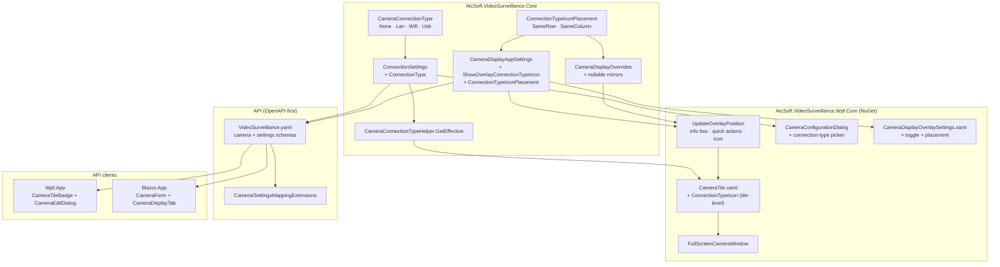

# 🔌 Camera Connection-Type Icon Roadmap

← Back to the [roadmap home](roadmap.md)

Plan for adding a **connection-type** attribute to every camera (`None`, `Lan`, `Wifi`, `Usb`), auto-detecting it where possible, letting the user set it, and showing it as an **optional icon in a corner of the camera tile**. The icon must never overlap the overlay info box or the quick-action buttons.

Affects **`AtcSoft.VideoSurveillance.Core`**, **`AtcSoft.VideoSurveillance.Wpf.Core`** (the `CameraTile` shipped in the NuGet packages, also used by `AtcSoft.CameraWall.Wpf.App`), **`AtcSoft.VideoSurveillance.Api`** (via the OpenAPI spec), **`AtcSoft.VideoSurveillance.Wpf.App`** (API client) and **`AtcSoft.VideoSurveillance.Blazor.App`** (forms and settings only).

---

## 🗂️ Status Legend

| Emoji | Meaning |
|-------|---------|
| ⬜ | Not started |
| 🟨 | In progress |
| ✅ | Complete |
| 🧪 | Test scaffolding only (red — no production code yet) |
| 🟩 | Test scaffolding green (production code passes the tests) |
| ⏸️ | Deferred (intentionally not in current scope) |
| ❌ | Cancelled / dropped |

Update this column on every PR that touches the roadmap.

---

## 🎯 Vision & Motivation

In a mixed installation, an operator can't tell from the camera wall how each camera is connected. That matters:

- **Wi-Fi cameras** drop out, stall and lose frames far more often than wired ones. When a tile goes `Reconnecting`, knowing it's a Wi-Fi camera points to the likely cause straight away.
- **USB cameras** are tied to the PC they are plugged into, and they disappear when unplugged or when another process takes the device.
- **LAN (wired / PoE) cameras** are the baseline. The icon mostly confirms that the camera is not the weak link.

Today the only connection hint is a hard-coded **"USB" text pill**. There are two of them: one in `CameraOverlay.xaml` and one in the API-client `CameraTileBadge.xaml`. Both are driven by `CameraSource`, and neither can be switched off. This roadmap turns that into a general, opt-in, user-editable indicator.

### End goal

> A user who wants to see how each camera is connected enables **"Show connection-type icon"** in Settings. Every tile then shows a small LAN / Wi-Fi / USB icon in a free corner. It never covers the title/status box or the quick-action buttons. Cameras set to `None` show no icon.

---

## 🧩 Data Model

### New enum — `CameraConnectionType` (Core)

```csharp
namespace AtcSoft.VideoSurveillance.Enums;

public enum CameraConnectionType
{
    None = 0,   // unknown / not set (default, and what old JSON deserializes to)
    Lan = 1,    // wired Ethernet / PoE
    Wifi = 2,   // IEEE 802.11
    Usb = 3,    // local USB / UVC device
}
```

### Where it lives: `ConnectionSettings.ConnectionType`

The property goes on `ConnectionSettings` in **both** the Core POCO and the Wpf.Core observable model, including `Clone` / `CopyFrom` / `ValueEquals` / `ToString`. It describes the link to the camera, so it belongs next to `Source`.

Existing `cameras.json` files have no `connectionType` field, so they deserialize to `None` with no migration needed.

### Invariants: `Source` vs. `ConnectionType`

`CameraSource` (Network / Usb) decides *how we open the stream*. `CameraConnectionType` is *what we show*. They overlap for USB, so the rules are:

| `Source` | Allowed `ConnectionType` | Effective (displayed) value |
|---|---|---|
| `Usb` | anything (ignored) | **always `Usb`** |
| `Network` | `None`, `Lan`, `Wifi` | stored value (`Usb` is treated as `None`) |

This is enforced in a Core helper in the style of `CameraUriHelper`, so every UI reads the same answer:

```csharp
public static class CameraConnectionTypeHelper
{
    public static CameraConnectionType GetEffective(ConnectionSettings connection);
}
```

- The camera dialog **forces `Usb`** (and disables the picker) when the source toggle flips to USB. It **resets to `None`** when the toggle flips back to Network.
- Renderers never read `ConnectionType` directly. They always go through `GetEffective`.

---

## 🔍 Auto-Detection

Detection confidence differs a lot by source, and the roadmap is honest about that:

| Case | Mechanism | Confidence | Phase |
|---|---|---|---|
| USB camera | `Source == Usb` | ✅ Deterministic | Phase 1 (free) |
| Network camera picked from the scanner | Scanner only gives IP, hostname and open ports, which don't show the camera's link type | ❌ Not possible | — |
| Network camera that speaks **ONVIF** | ONVIF Device Service `GetNetworkInterfaces`: the interface type / IEEE 802.11 extension shows wired vs. wireless (**exact fields to verify against the ONVIF Core spec**) | 🟨 Good, when the camera supports ONVIF and credentials are valid | Phase 6 |
| Vendor HTTP APIs (Hikvision ISAPI, Axis VAPIX, Dahua CGI) | Per-vendor network-interface endpoints | 🟨 Good, but one implementation per vendor | ⏸️ Deferred |
| Model-name heuristics (e.g. `…-IW`, "Wi-Fi" in the model name) | String match on hostname / model | ❌ Too unreliable to set a value, maybe usable as a *hint* only | ⏸️ Deferred |
| Latency / jitter / TTL sniffing | Statistical | ❌ Rejected: mixed networks make it meaningless | ❌ |

**Rules:**
- *Implicit* detection (on add, on first successful connect) only **fills in** the value while it is `None`. It **never overwrites** a value that is already set. Reconnecting or rescanning does not reset a manual choice.
- *Explicit* detection (the user clicks **Detect** in the camera dialog) may overwrite the current value. The user asked for it, and it covers a camera that was moved from Wi-Fi to cable.
- The user can **always override by hand**. The picker is never locked for network cameras.

ONVIF detection is **in scope for the first release** (Phase 6). There is no ONVIF code in the repo today, so Phases 1–5 still deliver a fully working feature with manual selection for network cameras. Phase 6 then adds auto-detection on top.

---

## 📐 Placement (No-Overlap by Construction)

### The constraint

A tile already uses two corners:

| Element | Corner |
|---|---|
| Info box (`CameraOverlay`: title / description / time / status) | `OverlayPosition`: **app default, per-camera display value, or per-camera override** |
| Quick actions (full-screen, zoom-reset) and their fixed-size hover hot-zone | **Diagonally opposite** the info box (`CameraTile.UpdateOverlayPosition`) |

That leaves exactly **two free corners**: the two adjacent to the info box.

### Why placement is stored *relative* to the info box

`OverlayPosition` can be overridden per camera. An absolute app-level setting such as "icon at TopRight" would collide on any camera whose info box is overridden to TopRight. So the icon placement is stored **relative to the info box**:

```csharp
public enum ConnectionTypeIconPlacement
{
    SameRow = 0,     // same top/bottom edge as the info box, opposite side (default)
    SameColumn = 1,  // same left/right side as the info box, opposite edge
}
```

| Info box at | `SameRow` → icon at | `SameColumn` → icon at | Quick actions at |
|---|---|---|---|
| TopLeft | **TopRight** | BottomLeft | BottomRight |
| TopRight | **TopLeft** | BottomRight | BottomLeft |
| BottomLeft | **BottomRight** | TopLeft | TopRight |
| BottomRight | **BottomLeft** | TopRight | TopLeft |

The icon can never land on the info box or quick-action corner, whatever override a camera has. `UpdateOverlayPosition` computes a third alignment pair (`ConnectionIconHorizontalAlignment` / `…VerticalAlignment`) next to the existing two.

**Settings UI:** the dropdown shows *concrete corner names* derived from the current default info-box position, e.g. "Top-right (same row)" / "Bottom-left (same column)". When the user changes the info-box position, the labels update. The stored value stays relative.

### Why the icon is a tile-level element

`CameraOverlay` is aligned to the info-box corner and sized to its content, so nothing inside it can reach another corner of the tile. That is also why the current USB pill sits awkwardly *inside* the info box area. The new icon is therefore a **sibling of `QuickActionsContainer` in `CameraTile.xaml`**, not a child of `CameraOverlay`.

---

## ⚙️ Settings

### App-level: `CameraDisplayAppSettings`

| Property | Type | Default | Notes |
|---|---|---|---|
| `ShowOverlayConnectionTypeIcon` | bool | `false` | Opt-in, per the feature request |
| `ConnectionTypeIconPlacement` | `ConnectionTypeIconPlacement` | `SameRow` | Relative to the info box |

### Per-camera: `CameraDisplayOverrides`

| Property | Type | Notes |
|---|---|---|
| `ShowOverlayConnectionTypeIcon` | bool? | `null` = inherit |
| `ConnectionTypeIconPlacement` | `ConnectionTypeIconPlacement?` | `null` = inherit |

⚠️ `CameraDisplayOverrides` keeps its members in sync by hand. **Every** one of `HasAnyOverride`, `ToString`, `Clone`, `CopyFrom` and `ValueEquals` must be updated, in both the Core and Wpf.Core versions. Unit tests (Phase 1) guard this.

The existing `OverlayOpacity` applies to the icon too, so it fades together with the info box.

---

## 🎨 Icon Design

- Three glyphs (LAN, Wi-Fi, USB), drawn as `Path` geometry to match the existing quick-action buttons (white 1.5 px stroke, 14×14), on the same semi-transparent dark pill (`#99000000`) the info box uses.
- Tooltip: localized connection-type name ("Wired (LAN)", "Wi-Fi", "USB").
- `None` → icon collapsed (not hidden), so it takes no hit-test area. No "?" placeholder (Decision 5).
- **Link-health tint** (Decision 4): the glyph's stroke follows the tile's `ConnectionState`. It applies to all three types, but it's most useful for Wi-Fi.

  | `ConnectionState` | Glyph stroke |
  |---|---|
  | `Connected` | White (normal) |
  | `Connecting` / `Reconnecting` | Amber |
  | `Disconnected` / `ConnectionFailed` | Red |

  The icon is only an indicator: the info box's status text stays the authoritative state. Reuse the existing `ConnectionStateToColorValueConverter` where its colours fit, so the tint matches the status dot.

---

## 🏛️ Architecture



---

## 🛣️ Phases

Test-first: each phase starts by adding failing tests in `AtcSoft.VideoSurveillance.Core.Tests` (🧪), then makes them pass (🟩), then ✅.

| # | Phase | Status |
|---|-------|--------|
| 1 | Core model, invariants and placement math | ✅ |
| 2 | WPF tile rendering (`CameraTile`, full screen) | 🟨 Built and unit-tested; awaiting a visual check |
| 3 | Settings and per-camera overrides UI (WPF) | 🟨 Built and unit-tested; awaiting a visual check |
| 4 | Camera dialog: connection-type picker and USB auto-set | ✅ |
| 5 | API, API-client WPF app and Blazor | ✅ |
| 6 | ONVIF auto-detection for network cameras | 🟨 Built and unit-tested; not yet tried against a real camera |
| 7 | Docs and USB-pill hand-over | ✅ |
| 8 | Remove legacy USB pills (next release) | ⬜ |

### Phase 1 — Core model, invariants and placement math ✅

- `CameraConnectionType` and `ConnectionTypeIconPlacement` enums, plus enum extensions for display text.
- `ConnectionSettings.ConnectionType` (Core POCO), including `Clone` / `CopyFrom` / `ValueEquals` / `ToString`.
- `CameraDisplayAppSettings` and `CameraDisplayOverrides` new members, including every hand-synced method.
- `CameraConnectionTypeHelper.GetEffective`.
- A **pure** corner resolver in Core so the placement table is unit-tested without WPF:
  `OverlayPosition ResolveConnectionIconCorner(OverlayPosition infoBox, ConnectionTypeIconPlacement placement)`.
- `DropDownItemsFactory` (Core and Wpf.Core): `ConnectionTypeItems`, `ConnectionTypeIconPlacementItems`.

**Tests**
- JSON round-trip, and old JSON without `connectionType` → `None`.
- `GetEffective`: Usb source always returns `Usb`, and Network + stored `Usb` returns `None`.
- Resolver: all 4 × 2 combinations; the result is never the info-box corner or its diagonal.
- Overrides: `HasAnyOverride` / `Clone` / `CopyFrom` / `ValueEquals` each include the new members.

### Phase 2 — WPF tile rendering 🟨

- Wpf.Core `ConnectionSettings` observable mirror, with `ConnectionType`.
- `CameraTile.xaml`: new tile-level icon element, sibling of `QuickActionsContainer`, aligned via new `ConnectionIconHorizontalAlignment` / `…VerticalAlignment` dependency properties.
- `CameraTile.xaml.cs`:
  - `ShowOverlayConnectionTypeIcon` and `ConnectionTypeIconPlacement` dependency properties, with effective-value resolution against overrides (same pattern as `GetEffectiveOverlayPosition`).
  - `UpdateOverlayPosition` also sets the icon alignment, using the Core resolver.
  - Refresh the icon when `Camera.Connection` changes. Today that triggers `RecreatePlayer()`; make sure the icon updates even when only `ConnectionType` changed, and ideally **don't** recreate the player for a display-only change.
- Link-health tint bound to the tile's `ConnectionState` (Decision 4).
- Legacy "USB" pill in `CameraOverlay.xaml` is hidden while the icon is enabled for that camera, and shown otherwise (Decision 1).
- `CameraGrid` passes the new settings through to each tile.
- `FullScreenCameraWindow` / view model: same icon and placement.
- Glyphs: LAN / Wi-Fi / USB `Path` geometries, and localized tooltips in `Translations.resx`.

### Phase 3 — Settings and per-camera overrides UI (WPF) 🟨

- `Dialogs/Parts/Settings/CameraDisplayOverlaySettings.xaml`: "Show connection-type icon" toggle and a placement `LabelComboBox` with **concrete corner labels** computed from the current `OverlayPosition`. Disabled when the toggle is off.
- `SettingsDialogViewModel`: bind, and recompute the placement labels when `OverlayPosition` changes.
- `ApplicationSettingsService`: persist the new members.
- `Dialogs/Parts/CameraConfigurations/DisplayOverridesPart.xaml`: tri-state inherit/on/off and a placement override.

### Phase 4 — Camera dialog: picker and USB auto-set ✅

- Connection-type `LabelComboBox` in the network connection part of `CameraConfigurationDialog`, offering `None` / `Lan` / `Wifi`.
- USB source: picker shows `USB` read-only.
- `CameraConfigurationDialogViewModel`: when `IsUsbSource` flips, set `Usb` or reset to `None`.
- New cameras added via the USB picker are stored with `ConnectionType = Usb`, so the stored value is correct as well as the effective one.

### Phase 5 — API, API-client WPF app and Blazor ✅

- `src/VideoSurveillance.yaml`:
  - `connectionType: enum [none, lan, wifi, usb]` on the camera schemas (the three with `source:`, near lines 453 / 563 / 625).
  - `showOverlayConnectionTypeIcon` and `connectionTypeIconPlacement` on the settings schema (near line 816).
  - Regenerate contracts.
- `Api.Domain/Mapping/CameraMappingExtensions.cs` and `SettingsMappingExtensions.cs`.
- `Api/Services/JsonApplicationSettingsService.cs`.
- `Wpf/Extensions/CameraModelMappingExtensions.cs`, `Wpf/Services/ApiApplicationSettingsService.cs`, `Wpf/Dialogs/CameraEditDialog*` and `Wpf/Dialogs/SettingsDialogViewModel.cs`.
- `Wpf/UserControls/CameraTileBadge.xaml` and `CameraTileViewModel`: expose `ConnectionType` and show the glyph **inline in the badge strip, next to the connection-state dot**, with the same link-health tint (Decision 2). The placement setting does not apply here. The "USB" text is hidden while the icon is enabled (Decision 1).
- Blazor: `Pages/CameraForm.razor` (picker), `SettingsTabs/CameraDisplayTab.razor` and `SettingsState.cs` (toggle and placement). `LiveView.razor` has no tile overlay today, so no icon rendering there.
- If the server sets `Usb` itself when a USB camera is added, the hub needs no new events. Changes to the connection type go through the existing camera-updated flow.

### Phase 6 — ONVIF auto-detection 🟨

In scope for the first release (Decision 6).

- An `ICameraConnectionTypeDetector` interface in Core, with an ONVIF implementation. It returns `CameraConnectionType` (`None` when unknown). An interface keeps vendor-specific detectors (Hikvision ISAPI, Axis VAPIX) possible later without touching callers.
- Minimal ONVIF Device-service client: SOAP `GetNetworkInterfaces` with WS-UsernameToken auth, reusing the camera's stored credentials. There is no ONVIF dependency today, so decide between hand-rolled SOAP (one request, small) and a library.
- Map the interface type to `Lan` / `Wifi`. **Verify the exact response fields against the ONVIF Core spec before implementing.** Cameras with several interfaces: use the one whose IP matches `Connection.IpAddress`.
- Triggers:
  - **Implicit**, when a network camera is added and after its first successful connect. Only fills in when the value is `None`.
  - **Explicit**, via a **Detect** button next to the picker in the camera dialog (WPF, API-client dialog and Blazor form). It may overwrite the current value.
- The user can always change the value by hand afterwards (Decision 6).
- Time-boxed (a few seconds) and non-blocking. A failure leaves the value unchanged, with no error dialog. The Detect button reports "Could not detect" inline.
- Server: expose detection so the API clients' Detect button works for cameras only the server can reach. For example, `POST /cameras/{id}/detect-connection-type` returning the detected type without saving it.

**Tests:** SOAP response parsing for wired, wireless, multi-interface and malformed responses (fixture XML); the fill-only-when-`None` rule for implicit triggers; explicit detection overwrites.

### Phase 7 — Docs and USB-pill hand-over ✅

- `docs/settings.md`: new settings and override rows.
- `docs/usb-cameras.md`: point to the connection-type icon.
- `CLAUDE.md` settings snippets: add the new `CameraDisplayAppSettings` members.
- Release notes: the USB pill now only appears while the connection-type icon is off, and it will be removed in the next release.

### Phase 8 — Remove legacy USB pills (next release) ⬜

- Delete the "USB" pill from `CameraOverlay.xaml` and the "USB" text from `CameraTileBadge.xaml`, along with the `IsUsbSource` plumbing that only fed them.
- The connection-type icon is then the only source indicator.

---

## ✅ Decisions

Resolved with the product owner. Revisit any of them if they don't work in practice.

| # | Question | Decision |
|---|----------|----------|
| 1 | What happens to the existing "USB" pills once the icon exists? | **Keep the pills while the connection-type icon is off, and hide them when it's on.** Remove them entirely in the next release (Phase 8). No regression for USB users in the meantime. |
| 2 | How does the API-client app (`Wpf.App`) show the icon in `CameraTileBadge`? | **Inline in the badge strip, next to the connection-state dot.** The corner placement setting doesn't apply there. Try it and adjust if needed. |
| 3 | Can the icon share the quick-actions corner? | **No.** The icon only uses the two corners adjacent to the info box, so it always stays in the same place. Try it and adjust if needed. |
| 4 | Should the icon reflect link health? | **Yes.** The glyph is tinted by `ConnectionState` (see Icon Design). In scope for Phase 2. |
| 5 | Should `None` show a placeholder icon? | **No.** `None` shows nothing. |
| 6 | Is ONVIF auto-detection in the first release? | **Yes, where possible** (Phase 6). The user can always override by hand. Implicit detection only fills `None`, and the explicit **Detect** button may overwrite. |

---

## 📝 Implementation Notes

Where the build differs from, or adds to, the plan above:

- **Implicit detection triggers.** The plan named "when a network camera is added". The network scanner doesn't know the credentials yet, so a probe there would usually fail authentication. Implicit detection runs instead after a successful **Test Connection** in the camera dialog (when a user name is set), and after a camera's **first successful connect**: in `CameraWallManager` (standalone) and `CameraConnectionService` → `CameraConnectionTypeAutoDetector` (server). Each camera is probed at most once per process.
- **Detect in the API clients** is available in edit mode only, because `POST /cameras/{id}/detect-connection-type` uses the stored credentials. New cameras rely on the server's implicit detection after they first connect.
- **Optional dependency.** `ICameraConnectionTypeDetector` is an optional constructor parameter everywhere (`DialogService`, `CameraConfigurationDialogViewModel`, `CameraWallManager`, `CameraConnectionService`), so hosts that consume the NuGet packages without registering it keep working. The Detect button is hidden when no detector is registered.
- **Display-only changes don't restart the stream.** A connection-type change is forwarded as `CameraConfiguration.EffectiveConnectionType`, not as `Connection`, so the tile updates its icon without recreating the player.
- **ONVIF details, confirmed only by unit tests with fixture XML:** SOAP 1.2 to `/onvif/device_service` on ports 80, 8080, 8000 and 2020 (all bounded by one overall timeout); a WS-Security PasswordDigest over the raw nonce bytes; the token timestamp aligned to the camera clock via `GetSystemDateAndTime`; classification from `Extension/Dot11` or IANA `InterfaceType` 6 / 71 only, never from interface names.
- **Tooltips.** The tile icon is `IsHitTestVisible="False"` so it doesn't block drag-and-drop on the tile, which means its tooltip never shows.
- **API-client app.** It reads the icon toggle when the live view loads, so changing it takes effect on the next live-view refresh.

### Still to verify by hand

- Both placements for each of the four info-box corners, in the grid and in full screen (where the icon must avoid the close button).
- The legacy "USB" badge hides when the icon is on and returns when it's off.
- The tint changes on connect, reconnect and disconnect.
- The placement dropdown keeps its selection after the default overlay position is changed (its labels are rebuilt then).
- Detection against real cameras: at least one wired and one Wi-Fi ONVIF camera, plus a Tapo camera on port 2020.
